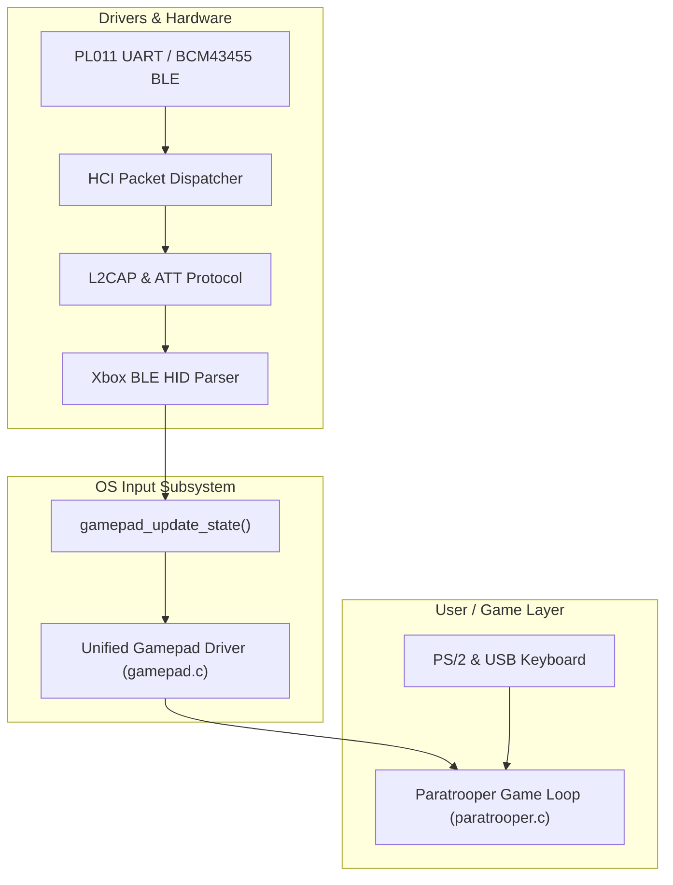

# Raspberry Pi ARM64, BLE & Xbox Gamepad Roadmap

This document outlines the architecture, implementation phases, and integration plan for running Antigravity OS on **Raspberry Pi (AArch64)** with **Bluetooth Low Energy (BLE)** support for the **Xbox Wireless Controller**, enabling direct gamepad gameplay in **Paratrooper**.

---

## 1. Subsystem Architecture

---

## 2. Paratrooper Input Mapping

The gamepad abstraction exposes standard directional states and action buttons. The game loop translates these to Paratrooper's internal BIOS scan codes:

| Xbox Controller Control | Internal Scan Code | Game Action |
|:---|:---|:---|
| **D-Pad Left** / **Left Stick Left** | `0x4B34` | Rotate Turret Left |
| **D-Pad Right** / **Left Stick Right** | `0x4D36` | Rotate Turret Right |
| **A Button** / **Right Trigger** / **RB** | `0x4838` | Fire Cannon |
| **Start / Menu** / **A (in title screen)** | `0x3920` | Start Game |
| **Back / View** / **Xbox Guide** | `0x0000` | Quit Game (Return to Shell) |

---

## 3. Implementation Milestones

### Milestone 1: Gamepad HAL & Paratrooper Input Integration (Complete)
- [x] Defined standardized gamepad state in `include/drivers/gamepad.h`.
- [x] Implemented unified gamepad state manager `kernel/drivers/input/gamepad.c`.
- [x] Hooked rate-limited analog & digital gamepad polling into `kernel/shell/paratrooper.c`.

### Milestone 2: BLE & Xbox Report Parser Scaffolding (Complete)
- [x] Defined HCI command, event, and ACL framing in `include/drivers/bluetooth.h`.
- [x] Implemented Xbox Controller 16-byte BLE HID Input Report parser in `kernel/drivers/bluetooth/xbox_ble.c`.
- [x] Implemented asynchronous HCI packet streaming and ATT handle-value event routing in `kernel/drivers/bluetooth/hci.c`.

### Milestone 3: Raspberry Pi AArch64 Hardware Abstraction Layer
- [x] Added ARM64 MMIO and system register headers (`include/hal/aarch64/arm.h`).
- [x] Added VideoCore Mailbox channel definitions (`include/hal/aarch64/mailbox.h`).
- [x] Added PL011 UART register layouts for Pi 3 / Pi 4 (`include/hal/aarch64/uart_pl011.h`).
- [ ] Create `kernel/arch/aarch64` entry assembly and exception vector tables.
- [ ] Implement VideoCore framebuffer allocation via mailbox tags.

### Milestone 4: Broadcom Bluetooth Firmware & Security Manager (SMP)
- [ ] Broadcom `.hcd` patchram firmware loader over PL011 UART.
- [ ] BLE Security Manager Protocol (SMP) pairing & AES-128 encryption key exchange for modern Xbox Series X/S controllers.
