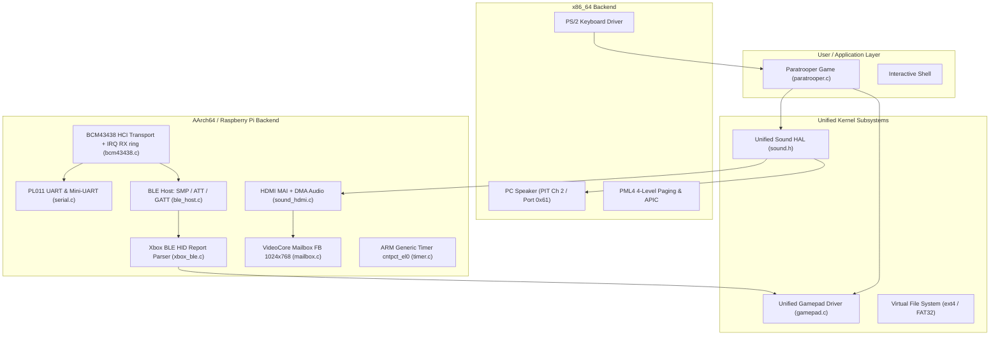
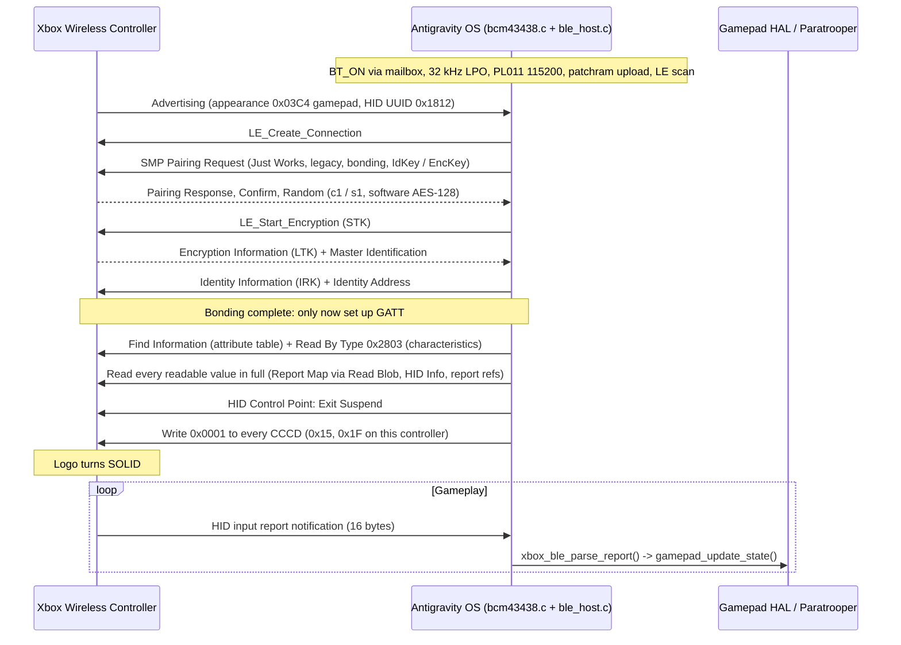

# Antigravity OS — Raspberry Pi AArch64, Bluetooth LE & Xbox Controller Guide

This document provides a comprehensive technical reference for running Antigravity OS on **Raspberry Pi (AArch64 / ARMv8-A)**, pairing an **Xbox Wireless Controller over Bluetooth Low Energy (BLE)**, outputting **HDMI audio (HDMI MAI FIFO fed by DMA)**, and playing **Paratrooper**.

---

## 1. System Architecture

Antigravity OS uses a Hardware Abstraction Layer (HAL) architecture separating architecture-specific drivers from portable kernel services and user applications:



---

## 2. Pairing an Xbox Wireless Controller

### 2.1 Physical Controller Steps

To connect a modern Xbox Wireless Controller (Model 1708 or Model 1914 Series X|S) to the Raspberry Pi:

1. **Power On**: Press the center **Xbox Guide button** (it will flash slowly).
2. **Enter Pairing Mode**: Press and hold the small circular **Pairing button** on the top edge (adjacent to the USB-C port and Left Bumper) for **3 seconds**.
3. **LED Indication**: The Xbox logo button will begin **flashing rapidly**, signaling that it is actively advertising as `"Xbox Wireless Controller"` and ready for pairing.

```
       [ Pairing Button ]
             ╭───╮
  ┌──────────┴───┴──────────┐
  │   [LT]            [RT]  │
  │   [LB]            [RB]  │
  │       ╭─────────╮       │
  │       │  ( X )  │ <──── Flashing rapidly = Pairing mode
  │       ╰─────────╯       Solid white      = Paired & Active
```

### 2.2 Bluetooth Protocol Flow (verified on Pi 3B, 2026-10-28)

The host stack is `bcm43438.c` (radio bring-up, HCI transport, scan/connect) plus `ble_host.c`
(L2CAP, SMP, ATT/GATT). In pairing mode the controller only leaves pairing mode (solid light)
and sends input once the Pi behaves like a complete HID host, so every step below is needed:



### 2.3 Lessons from Bring-up
- **Security**: the controller requires an encrypted, bonded link. Legacy Just Works pairing is
  accepted; LE Secure Connections (P-256) is not needed.
- **Pairing mode** needs the full HID-host behaviour above (bond first, send our identity keys,
  read the HID values, then subscribe). Writing CCCDs before bonding finished gave a link that
  stayed silent with the light flashing.
- **Most characteristic value types arrive as 128-bit UUIDs** that are not on the Bluetooth base,
  so the gamepad report cannot be picked by type; the host subscribes to every CCCD and parses any
  notification of gamepad size.
- **Keys are RAM-only**, which is fine: after a Pi reboot a normal power-on of the controller
  reconnects and accepts a fresh pairing.
- **UART**: the PL011 FIFO is 16 bytes (~1.4 ms at 115200), so RX is interrupt-driven into a
  4 KB ring; scanning always uses duplicate filtering to avoid flooding the link.

### 2.4 Debugging
Set `BLE_DEBUG_SCREEN` to 1 in `include/drivers/bluetooth.h` for on-screen debug rows: radio,
link state (`[BLE LINK]`: state, ATT errors, keys, reads, CCCDs, notifications), UART diagnostics,
HDMI audio state, the GATT attribute table and the last notification bytes.
The Pi boots to the shell; `autostart=paratrooper` in `antigravity.cfg` (SD card) starts the game instead.
With `BLE_DEBUG_SCREEN` 0, runtime `[BLE]` messages go to the serial console only.

---

## 3. Gamepad Input Mapping (Paratrooper)

The unified Gamepad HAL maps analog thumbstick thresholds and button presses to Paratrooper's internal BIOS scan codes:

| Xbox Controller Control | Internal Code | Game Action |
|:---|:---|:---|
| **D-Pad Left** / **Left Stick Left** (`< -12000`) | `0x4B34` | Rotate Cannon Turret Left |
| **D-Pad Right** / **Left Stick Right** (`> 12000`) | `0x4D36` | Rotate Cannon Turret Right |
| **A Button** / **Right Trigger** / **RB** | `0x4838` | Fire Cannon Shell |
| **Menu / Start** / **A (Attract Mode)** | `0x3920` | Start Game / Enter Title Screen |
| **View / Back** / **Xbox Guide Button** | `0x0000` | Exit to Shell |

---

## 4. Audio Architecture (HDMI vs PC Speaker)

Antigravity OS features an audio HAL ([`include/drivers/sound.h`](file:///f:/priyan/Projects/AI/OS/include/drivers/sound.h)) providing identical gameplay audio across different architectures:

```
                      ┌──────────────────────────────────────┐
                      │    Paratrooper / Shell Sound API     │
                      │  sound_init(), sound_play_divisor()  │
                      └──────────────────┬───────────────────┘
                                         │
                    ┌────────────────────┴────────────────────┐
                    ▼                                         ▼
      ┌───────────────────────────┐             ┌───────────────────────────┐
      │     x86_64 Audio Driver   │             │   Raspberry Pi (AArch64)  │
      │   (PC Speaker / PIT Ch 2) │             │   (HDMI MAI FIFO + DMA)   │
      └─────────────┬─────────────┘             └─────────────┬─────────────┘
                    │                                         │
                    ▼                                         ▼
          Ports 0x61 & 0x43                       DMA ch 5 (DREQ 17) -> MAI
           Internal Beeper                            HDMI audio packets
                                                              │
                                                              ▼
                                                        HDMI TV Speakers
```

* **x86_64 Backend** ([`kernel/arch/x86_64/sound.c`](file:///f:/priyan/Projects/AI/OS/kernel/arch/x86_64/sound.c)): Directly programmes 8254 PIT Timer channel 2 (`0x42`/`0x43`) and enables the speaker gate bit on port `0x61`.
* **Raspberry Pi Backend** (`kernel/arch/aarch64/drivers/sound_hdmi.c`): feeds the HDMI MAI audio FIFO by DMA from a looping buffer of 48 kHz IEC958 subframes; `sound_play_tone()` rewrites the buffer with a square wave. N/CTS from the mailbox pixel clock, Audio InfoFrame in HDMI RAM packet 4; register sequence follows Linux vc4_hdmi. Verified on HDMI TV speakers (2026-10-28). The earlier VCHIQ driver was a placeholder that never sent audio.

---

## 5. Multi-Architecture Build & Disk Packaging

Antigravity OS includes automated multi-architecture build scripts:

### 5.1 Quick Build Commands

#### From Linux / WSL:
```bash
# Build Raspberry Pi AArch64 SD card image & kernel
./build.sh aarch64

# Build x86_64 PC Hybrid ISO & ext4 disk
./build.sh x86_64

# Build all architectures
./build.sh all

# Clean build artifacts
./build.sh clean
```

#### From Windows PowerShell:
```powershell
.\build.ps1 aarch64
.\build.ps1 x86_64
.\build.ps1 all
```

### 5.2 Output Artifacts Structure

Generated outputs are strictly compartmentalized in `output/<arch>`. For Raspberry Pi, all required VideoCore GPU bootloader files are automatically included:

```
output/
├── aarch64/
│   ├── antigravity-rpi.img      # 64 MB flashable SD card disk image (MBR + FAT32 with all firmware)
│   ├── bootcode.bin             # 52 KB VideoCore GPU Stage 2 bootloader
│   ├── start.elf                # 2.9 MB VideoCore GPU OS firmware
│   ├── fixup.dat                # 7.3 KB GPU/ARM SDRAM memory splitter
│   ├── LICENCE.broadcom         # Licence of the GPU boot firmware (must ship with it)
│   ├── LICENSE.cypress          # Licence of the Bluetooth patchram linked into kernel8.img
│   ├── config.txt               # GPU firmware config (arm_64bit=1, HDMI boost, UART)
│   ├── kernel8.img              # ~105 KB raw binary loaded by VideoCore at 0x80000
│   └── kernel8.elf              # 319 KB AArch64 ELF with debug symbols
│
└── x86_64/
    ├── antigravity-os.iso       # 5.2 MB hybrid BIOS/UEFI Limine bootable ISO
    ├── disk.img                 # 32 MB ext4 filesystem image
    └── kernel.elf               # 680 KB x86_64 ELF kernel binary
```

---

## 6. Real Hardware Deployment & Verification

### 6.1 Verified Hardware Target: Raspberry Pi 3 Model B
> [!NOTE]
> Bare-metal boot has been **physically verified on a real Raspberry Pi 3 Model B** over HDMI with full video output and green ACT activity light.
> Xbox Wireless Controller over Bluetooth LE (pairing mode, normal reconnect, Pi reboot) and HDMI audio were verified on the same board on 2026-10-28.

### 6.2 Raspberry Pi Hardware Boot Chain Note
Unlike x86 PCs, the Raspberry Pi's ARM CPU cannot boot from cold power. The Broadcom VideoCore GPU boot ROM must first load `bootcode.bin` and `start.elf`. Without these files on the FAT32 partition, the green ACT LED remains dark and the board will not power the ARM CPU or HDMI controller.

The Makefile (`make ARCH=aarch64`, also run by `build.sh aarch64`) downloads these files from a pinned raspberrypi/firmware commit, plus the BCM43430A1 Bluetooth patchram from a pinned RPi-Distro/bluez-firmware commit, into `firmware-rpi/` (git-ignored, never committed for licence reasons), and packages them with their licence files into `output/aarch64/` and `antigravity-rpi.img`. No device tree is shipped: the kernel does not use one.

### 6.3 Flashing to Physical MicroSD Card

To run on a real Raspberry Pi 3:
* **Option A (Direct File Copy)**: If you already have a FAT32-formatted SD card, simply copy all files from `output/aarch64/` to the root of the card.
* **Option B (Raw Disk Flash)**: Flash `output/aarch64/antigravity-rpi.img` using **Raspberry Pi Imager** ("Use Custom Image"), **Rufus**, or `dd`:
   ```bash
   sudo dd if=output/aarch64/antigravity-rpi.img of=/dev/sdX bs=4M status=progress conv=fsync
   ```

### 6.4 Testing in QEMU Emulation
* **Direct Kernel Execution**:
  ```bash
  make ARCH=aarch64 run
  ```
* **Full Partitioned SD Card Disk Emulation**:
  ```bash
  make ARCH=aarch64 run-sd
  ```

---

## 7. Implementation Checklist

- [x] Standardized Gamepad HAL (`include/drivers/gamepad.h`, `kernel/drivers/input/gamepad.c`).
- [x] Paratrooper Gamepad Integration (`kernel/shell/paratrooper.c`).
- [x] Multi-Architecture Build Scripts (`build.sh`, `build.ps1`, `Makefile`).
- [x] AArch64 Bootloader & Multicore Spin-Lock (`kernel/arch/aarch64/boot.S`).
- [x] AArch64 Linker Script at `0x80000` (`kernel/arch/aarch64/linker.ld`).
- [x] VideoCore Mailbox Framebuffer at 1024x768 (`kernel/arch/aarch64/mailbox.c`).
- [x] PL011 UART & Mini-UART Drivers (`kernel/arch/aarch64/serial.c`).
- [x] ARM Generic Timer Driver (`kernel/arch/aarch64/timer.c`).
- [x] Unified Sound HAL (`include/drivers/sound.h`).
- [x] PC Speaker x86_64 Sound Driver (`kernel/arch/x86_64/sound.c`).
- [x] HDMI Audio Driver, MAI + DMA (`kernel/arch/aarch64/drivers/sound_hdmi.c`). Replaces the VCHIQ placeholder, which never sent audio.
- [x] EL1 exception vectors with on-screen fault report and UART0 RX IRQ (`kernel/arch/aarch64/boot.S`); aarch64 built with `-mstrict-align` (MMU off: unaligned accesses fault).
- [x] Xbox Wireless Controller 16-byte BLE HID Report Parser (`kernel/arch/aarch64/drivers/bluetooth/xbox_ble.c`).
- [x] **Step 1**: Dedicated PL011 UART driver to BCM43438 Bluetooth chip (GPIO 30-33, pinmux, CTS/RTS).
- [x] **Step 2**: Broadcom BCM43438 `.hcd` patchram firmware loader over UART (`BCM43430A1.hcd`).
- [x] **Step 3**: HCI command/ACL transport (`bcm43438_send_cmd`, `bcm43438_send_acl`), `HCI_Reset`, and active BLE scanning with duplicate filtering.
- [x] **Step 4**: BLE connection establishment (`HCI_LE_Create_Connection`).
- [x] **Step 5**: SMP legacy Just Works pairing with software AES-128, bonding and identity key distribution (`kernel/arch/aarch64/drivers/bluetooth/ble_host.c`).
- [x] **Step 6**: GATT discovery, HID value reads, Exit Suspend and CCCD `0x2902` subscription (`ble_host.c`).
- [x] **Step 7**: HID report routing to the Gamepad HAL; buttons, sticks and triggers verified on the debug screen.
- [ ] L2CAP/ACL reassembly: not needed while ATT MTU stays 23 (every PDU fits one 27-byte LE fragment).
- [ ] Persisting pairing keys: not needed (the controller accepts a fresh pairing after every Pi boot).
