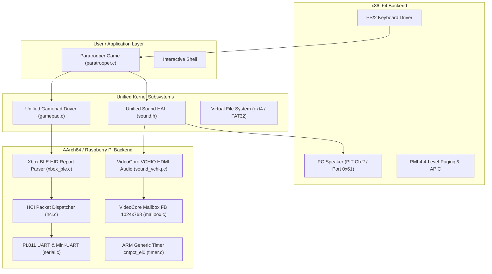
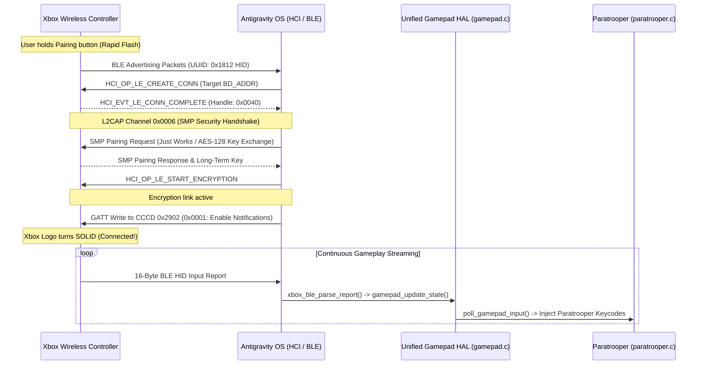

# Antigravity OS — Raspberry Pi AArch64, Bluetooth LE & Xbox Controller Guide

This document provides a comprehensive technical reference for running Antigravity OS on **Raspberry Pi (AArch64 / ARMv8-A)**, pairing an **Xbox Wireless Controller over Bluetooth Low Energy (BLE)**, outputting **HDMI Audio via VideoCore VCHIQ**, and playing **Paratrooper**.

---

## 1. System Architecture

Antigravity OS uses a Hardware Abstraction Layer (HAL) architecture separating architecture-specific drivers from portable kernel services and user applications:



---

## 2. Pairing an Xbox Wireless Controller

### 2.1 Physical Controller Steps

To connect a modern Xbox Wireless Controller (Model 1708 or Model 1914 Series X|S) to the Raspberry Pi:

1. **Power On**: Press the center **Xbox Guide button** (it will flash slowly).
2. **Enter Pairing Mode**: Press and hold the small circular **Pairing button** on the top edge (adjacent to the USB-C port and Left Bumper) for **3 seconds**.
3. **LED Indication**: The Xbox logo button will begin **flashing rapidly**, signaling that it is actively advertising as `"Xbox Wireless Controller"` and ready for pairing.

```
       [ Pairing Button ]
             ╭───╮
  ┌──────────┴───┴──────────┐
  │   [LT]            [RT]  │
  │   [LB]            [RB]  │
  │       ╭─────────╮       │
  │       │  ( X )  │ <──── Flashing rapidly = Pairing mode
  │       ╰─────────╯       Solid white      = Paired & Active
```

### 2.2 Low-Level Bluetooth Protocol Handshake

Under the hood, the kernel executes an automated 5-stage BLE protocol handshake:



### 2.3 Critical BLE Security (SMP) Requirement
Modern Xbox controllers enforce **BLE Security Mode 1 (Encrypted Link)**. If the host operating system does not negotiate the Security Manager Protocol (SMP) handshake and activate AES-128 link encryption, the controller automatically severs the connection after 2 seconds.

---

## 3. Gamepad Input Mapping (Paratrooper)

The unified Gamepad HAL maps analog thumbstick thresholds and button presses to Paratrooper's internal BIOS scan codes:

| Xbox Controller Control | Internal Code | Game Action |
|:---|:---|:---|
| **D-Pad Left** / **Left Stick Left** (`< -12000`) | `0x4B34` | Rotate Cannon Turret Left |
| **D-Pad Right** / **Left Stick Right** (`> 12000`) | `0x4D36` | Rotate Cannon Turret Right |
| **A Button** / **Right Trigger** / **RB** | `0x4838` | Fire Cannon Shell |
| **Menu / Start** / **A (Attract Mode)** | `0x3920` | Start Game / Enter Title Screen |
| **View / Back** / **Xbox Guide Button** | `0x0000` | Exit to Shell |

---

## 4. Audio Architecture (VCHIQ HDMI vs PC Speaker)

Antigravity OS features an audio HAL ([`include/drivers/sound.h`](file:///f:/priyan/Projects/AI/OS/include/drivers/sound.h)) providing identical gameplay audio across different architectures:

```
                      ┌──────────────────────────────────────┐
                      │    Paratrooper / Shell Sound API     │
                      │  sound_init(), sound_play_divisor()  │
                      └──────────────────┬───────────────────┘
                                         │
                    ┌────────────────────┴────────────────────┐
                    ▼                                         ▼
      ┌───────────────────────────┐             ┌───────────────────────────┐
      │     x86_64 Audio Driver   │             │   Raspberry Pi (AArch64)  │
      │   (PC Speaker / PIT Ch 2) │             │  (VideoCore VCHIQ HDMI)   │
      └─────────────┬─────────────┘             └─────────────┬─────────────┘
                    │                                         │
                    ▼                                         ▼
          Ports 0x61 & 0x43                          VCHIQ Mailbox (Ch 3)
           Internal Beeper                              VideoCore GPU
                                                              │
                                                              ▼
                                                        HDMI TV Speakers
```

* **x86_64 Backend** ([`kernel/arch/x86_64/sound.c`](file:///f:/priyan/Projects/AI/OS/kernel/arch/x86_64/sound.c)): Directly programmes 8254 PIT Timer channel 2 (`0x42`/`0x43`) and enables the speaker gate bit on port `0x61`.
* **Raspberry Pi Backend** ([`kernel/arch/aarch64/sound_vchiq.c`](file:///f:/priyan/Projects/AI/OS/kernel/arch/aarch64/sound_vchiq.c)): Handshakes with the VideoCore GPU firmware via VCHIQ over Mailbox Channel 3. Converts retro frequency divisors into 44.1 kHz 16-bit stereo PCM buffers and streams them to the `AUDS` service for HDMI injection.

---

## 5. Multi-Architecture Build & Disk Packaging

Antigravity OS includes automated multi-architecture build scripts:

### 5.1 Quick Build Commands

#### From Linux / WSL:
```bash
# Build Raspberry Pi AArch64 SD card image & kernel
./build.sh aarch64

# Build x86_64 PC Hybrid ISO & ext4 disk
./build.sh x86_64

# Build all architectures
./build.sh all

# Clean build artifacts
./build.sh clean
```

#### From Windows PowerShell:
```powershell
.\build.ps1 aarch64
.\build.ps1 x86_64
.\build.ps1 all
```

### 5.2 Output Artifacts Structure

Generated outputs are strictly compartmentalized in `output/<arch>`:

```
output/
├── aarch64/
│   ├── antigravity-rpi.img  # 64 MB flashable SD card disk image (MBR + FAT32 boot partition)
│   ├── config.txt           # GPU firmware configuration (arm_64bit=1, enable_uart=1)
│   ├── kernel8.img          # 49 KB raw binary loaded by VideoCore at 0x80000
│   └── kernel8.elf          # 319 KB AArch64 ELF with debug symbols
│
└── x86_64/
    ├── antigravity-os.iso   # 5.2 MB hybrid BIOS/UEFI Limine bootable ISO
    ├── disk.img             # 32 MB ext4 filesystem image
    └── kernel.elf           # 680 KB x86_64 ELF kernel binary
```

---

## 6. Testing in QEMU & Flashing Physical Media

### 6.1 Testing Raspberry Pi in QEMU

* **Direct Kernel Execution**:
  ```bash
  make ARCH=aarch64 run
  ```
* **Full Partitioned SD Card Disk Emulation**:
  ```bash
  make ARCH=aarch64 run-sd
  ```

### 6.2 Flashing to Physical MicroSD Card

To run on a real Raspberry Pi 3 or Pi 4:
1. Insert a MicroSD card into your host machine.
2. Flash `output/aarch64/antigravity-rpi.img` using **Raspberry Pi Imager** ("Use Custom Image"), **Rufus**, or `dd`:
   ```bash
   sudo dd if=output/aarch64/antigravity-rpi.img of=/dev/sdX bs=4M status=progress conv=fsync
   ```
3. Insert the card into your Raspberry Pi, connect HDMI and power on.

---

## 7. Implementation Checklist

- [x] Standardized Gamepad HAL (`include/drivers/gamepad.h`, `kernel/drivers/input/gamepad.c`).
- [x] Paratrooper Gamepad Integration (`kernel/shell/paratrooper.c`).
- [x] Multi-Architecture Build Scripts (`build.sh`, `build.ps1`, `Makefile`).
- [x] AArch64 Bootloader & Multicore Spin-Lock (`kernel/arch/aarch64/boot.S`).
- [x] AArch64 Linker Script at `0x80000` (`kernel/arch/aarch64/linker.ld`).
- [x] VideoCore Mailbox Framebuffer at 1024x768 (`kernel/arch/aarch64/mailbox.c`).
- [x] PL011 UART & Mini-UART Drivers (`kernel/arch/aarch64/serial.c`).
- [x] ARM Generic Timer Driver (`kernel/arch/aarch64/timer.c`).
- [x] Unified Sound HAL (`include/drivers/sound.h`).
- [x] PC Speaker x86_64 Sound Driver (`kernel/arch/x86_64/sound.c`).
- [x] VideoCore VCHIQ HDMI Audio Driver (`kernel/arch/aarch64/sound_vchiq.c`).
- [x] BLE HCI Packet Streamer & Router (`kernel/drivers/bluetooth/hci.c`).
- [x] Xbox Wireless Controller BLE HID Report Parser (`kernel/drivers/bluetooth/xbox_ble.c`).
- [ ] Broadcom BCM43455 Bluetooth `.hcd` patchram firmware streaming over PL011 UART.
- [ ] Standalone Security Manager Protocol (SMP) cryptographic AES-128 engine for physical BLE pairing.
